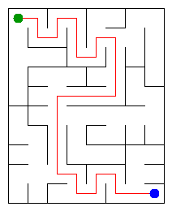

# Assignment 3. Maze Escape

- **Student ID:** 250767
- **Name:** Yerkhan Ibragim
- **Group:** SE-2510
- **Maze size:** 10 x 8 (80 cells, 142 inner walls)
- **Language:** Java 17 or newer; Java standard library only

## Run

Open the project folder containing `src`, `data`, and this README. Run:

```bash
javac -d out src/*.java
java tools/Check.java
java -cp out Main
```

`Check` runs the three supplied examples. Run `Main` afterwards to restore the picture for student 250767. Open `output/maze.html` to see the interactive maze.

To regenerate the personal input files:

```bash
java tools/MakeVariant.java 250767 data
```

## Program output

```text
Broken: 79
Kept: 63
Last broken wall: 124
MST cost: 26646
Heaviest broken wall: 737
Path length: 28
DFS visited: 61
Dead ends: 23
Zones: 11
Largest zone: 11
Is DAG: 0
Flow stages: 5
Fastest route cost: 23
```

Kruskal MST cost: **26646**. Prim MST cost: **26646**.



The red line is the path in the Mission 1 maze. Green is the start; blue is the exit.

## Questions

**Mission 0. What do find and union do, and what makes them fast?**

`find(x)` returns the root of the set containing x. `union(a, b)` joins two different sets and returns true; if they are already together, it returns false. Union by size keeps the smaller tree under the larger tree, and path compression makes visited cells point directly to their root.

**Mission 1. Why is Broken always R*C - 1, and Kept always (R-1)*(C-1)?**

There are n = R*C separate cells at the start, and every successful union reduces the number of sets by one. A complete rectangular grid is connected, so exactly n-1 walls must be broken to form a tree. There are R*(C-1) + C*(R-1) inner walls, so Kept = R*(C-1) + C*(R-1) - (R*C-1) = (R-1)*(C-1).

**Mission 2. My MST cost from Kruskal and Prim, and why they are equal.**

Both algorithms give 26646. Kruskal takes the cheapest wall that joins two different components, while Prim takes the cheapest wall connecting its current tree to an unvisited cell. Both construct a minimum spanning tree, and the different wall costs make this MST unique.

**Mission 3. Why is there exactly one path? How is stack overflow avoided?**

The maze is connected and contains no cycle, so it is a tree. Two different simple paths between the same cells would create a cycle. The DFS uses an explicit array stack and remembers the next direction for each cell, so it does not depend on recursive Java calls; cells are marked only when DFS enters them.

**Mission 4. Why is the second Kosaraju pass on the reversed graph? Why is Zones = n equivalent to no cycle?**

The first pass records DFS finishing order, and the second processes cells from last finished to first. Reversing the slides preserves each SCC but reverses connections between SCCs, so a second-pass search cannot leave its component for an unassigned component in this order. Because self-loops are forbidden in the input, a directed cycle would put at least two cells in one SCC; therefore the graph has no cycle exactly when every cell is its own zone.

**Mission 5. Why is zone-number order enough, and what does the pass cost?**

Kosaraju assigns the zones in topological order: every edge between different zones goes from a smaller number to a larger number. When a zone is processed, all its incoming contributions are already known, so one forward pass computes both the longest chain and the cheapest route; the longest-chain values start at 1 for every zone, but only the start zone has distance 0. For k zones and e distinct zone edges, this pass takes O(k+e) time; building the graph with the minimum parallel-edge cost takes expected O(n+m) time overall using hash maps.

## AI use

OpenAI ChatGPT was used to draft the Java implementations and README explanations, and to help test and review the solution. It ran the provided checks and benchmark in its Linux environment. The code and report are AI-assisted drafts: the student must review, adapt, and understand them before submission, as required by the assignment.

The starter code, input generator, example checker, renderer, and benchmark were supplied by the course. No third-party graph or DSU library was used. Local commits are attributed to ChatGPT and record the preparation of this draft.

## Timing (Mission 7)

Measured with the unchanged supplied `Bench` class, five runs for every size and algorithm. Values are milliseconds; the last column is the average printed by Bench.

Environment: OpenJDK 17.0.20, Linux x86_64, AMD EPYC 9V74 virtual CPU, 1 GiB maximum Java heap. These measurements are from the preparation environment, not the student's laptop.

```bash
java -Xmx1g -cp out Bench
```

| Maze | Kruskal: 5 runs (ms) | Average (ms) | Prim: 5 runs (ms) | Average (ms) |
|---|---|---:|---|---:|
| 100 x 100 | 19, 10, 15, 21, 20 | 17 | 21, 6, 8, 6, 5 | 9 |
| 300 x 300 | 119, 89, 61, 63, 55 | 78 | 85, 69, 75, 73, 85 | 77 |
| 1000 x 1000 | 1173, 1360, 1200, 1283, 1359 | 1275 | 2458, 2550, 2500, 2476, 2515 | 2500 |

Increasing each side of the maze increases the number of cells quadratically, so both algorithms take much longer on large grids. Both have O(n*log n) time on this grid, but sorting and priority-queue work have different constant costs; Kruskal was faster on the largest case here. JVM warm-up, garbage collection, and scheduling affect the small cases, so these measurements illustrate growth without proving a complexity bound.

## Complexity

n is the number of cells; m is the number of walls or slides. k is the number of zones, and e is the number of distinct edges between zones. Space includes auxiliary graph structures and returned results, but excludes the supplied input arrays.

| Algorithm | Time | Space | Assumptions |
|---|---|---|---|
| DSU initialization | O(n) | O(n) | Each cell starts in its own set |
| DSU find and union | O(alpha(n)) amortized per operation | O(n) for the DSU; O(1) per call | Union by size and path compression; a single operation is O(log n) worst case |
| DSU connected / count | O(alpha(n)) amortized / O(1) | O(1) per call | connected performs two finds |
| Build maze in file order | O(n + m*alpha(n)) | O(n) | Connected rectangular grid; no sorting |
| Kruskal | O(n + m*log m) | O(n+m) | Sort wall indexes; connected grid |
| Prim | O(n + m*log m) | O(n+m) | Lazy priority queue of edges; each wall is inserted at most once |
| Escape DFS | O(n) | O(n) | A tree maze with n-1 open walls and at most four neighbours per cell; general DFS is O(n+m) |
| Kosaraju | O(n+m) | O(n+m) | Two iterative DFS passes and forward/reverse adjacency lists |
| Route in the zone graph | O(k+e) for the pass; expected O(n+m) including construction | O(k+e) | Topological zone IDs; expected O(1) hash-map operations |

alpha(n) is the inverse Ackermann function; it grows extremely slowly. In a grid m = O(n), so both MST implementations take O(n*log n) time and O(n) space.

## Before submission

- [x] Source code, personal input files, and maze picture are included.
- [x] All supplied examples pass; README contains the output and AI use note.
- [x] The main branch has commits for the implementation missions.
- [ ] Review and adapt the AI-assisted solution and explanations; prepare to explain every line.
- [ ] Push main to a public GitHub repository and check that its link opens when signed out.
- [ ] Submit the public repository link in Moodle before the deadline.
